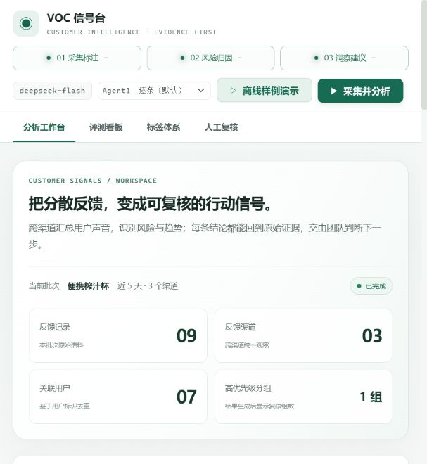

# VOC 信号台 · 客户声音智能分析平台

<p align="center"></p>


**一句话：**把散落在商品评价、客服对话和退款说明里的用户反馈，整理成带原文证据的问题信号、风险分级和后续行动建议。

面向没有专职数据团队、却要处理大量客户反馈的中小电商卖家。项目重点是展示如何让 AI 结论可追溯、可复核，并能进入后续迭代。

## 先用 30 秒了解项目

- **输入：**多渠道反馈、商品信息、用户关联标识和历史信号。
- **处理：**三个 Agent 分别完成反馈标注、风险归因和行动建议；规则聚合减少重复报告，高风险信号进入人工复核。
- **输出：**可回溯到原始反馈的风险分组、洞察报告和证据编号。
- **快速体验：**本地启动后点击「离线样例演示」，无需 API Key 即可查看固定样例结果。

离线样例是项目内预先整理的固定输出，不会调用模型、不产生 API 费用，也不代表实时推理效果。要运行真实模型流程，仍需自行配置模型 API Key。仓库目前没有免密在线演示。

## 快速阅读入口

| 想了解什么 | 项目证据 |
| --- | --- |
| 产品流程 | [工作台截图](docs/screenshot-workbench.png)、[评测看板截图](docs/screenshot-eval.png) |
| 数据对象与问题追踪 | `feedback_id`、`customer_ref`、渠道、标签、风险和证据编号；支持跨渠道关联与原文回溯，见 [Agent 数据契约](prompts/00-shared-schema.md) |
| Agent 编排与失败处理 | 三个 Agent 分工、规则聚合、结构校验、批量对齐失败回退，见 `prototype/pipeline.js` |
| 质量评测与 Badcase | 30 条场景用例、分层指标、失败归因与复测，见 [评测口径](eval/metrics.md) 和 [评测脚本](eval/run_eval.py) |
| 人工复核闭环 | 高风险信号进入人工复核；确认的标签与复核结论可回流到后续 Prompt |

**项目边界：**这是电商 VOC 的本地交互原型，不是智能硬件生产系统。样例数据为自建数据，尚未接入真实 RMA、产品版本、供应商/批次、制造测试记录，也没有线上 A/B 结果；因此项目展示的是问题追踪、Agent 编排和评测方法的可迁移实践，不声称已完成硬件研发质量闭环。

**建议查看顺序：**[工作台截图](docs/screenshot-workbench.png) → [评测看板截图](docs/screenshot-eval.png) → [指标口径](eval/metrics.md)。

## 这个项目解决什么

| 痛点 | 具体表现 | 本项目的应对 |
| --- | --- | --- |
| 反馈散落多渠道 | 评价、客服记录、退款说明在三个后台，人工整理耗时巨大 | Agent1 统一打标为结构化反馈卡 |
| 单渠道看不穿 | 退款原因写「不喜欢」，客服记录里说的却是「用了两天就坏了」 | Agent2 注入同用户跨渠道记录做交叉验证 |
| 差评突然增多才发现 | 没有预警，等发现时已经影响转化率 | 三级风险判定 + 高风险强制人工复核 |
| 结论不可信 | 模型给了一堆建议，不知道基于什么 | 证据链带语料编号，可下钻到原始评论 |

## 三个 Agent 的职责

| Agent | 输入 | 输出 | 自主级别 |
| --- | --- | --- | --- |
| 01 信号采集与标注 | 单条反馈 | 标签（8 类多选）/ 情感 / 实体 / 是否新信号 | 全自动 |
| 02 风险识别与归因 | 反馈卡 + 7 天历史信号库 + 同用户跨渠道记录 | 高 / 观察 / 常规 + 归因 + 是否需人工复核 | 高风险转人工 |
| 03 洞察生成与行动建议 | 聚合后的风险结果 + 历史统计 | Markdown 洞察报告 + 优先级行动表 | 只建议，不执行 |

Agent3 之前有一层**聚合层**（纯规则，不含模型调用）：按「风险等级 + 主标签」归组，合并证据与归因，只为「高」和「观察」生成报告。没有它，9 条反馈会产出 9 份高度重复的报告。

## 三处增补（相对原始 Prompt）

三个 Agent 的 Prompt 以原始版本为基线，只在原文上做加法：

| 编号 | 位置 | 增补内容 |
| --- | --- | --- |
| 1 | Agent2 · 输入 | 「你会收到该用户在其他渠道的历史反馈记录。若存在跨渠道记录，请交叉验证说法是否一致。」 |
| 2 | Agent1 · 输出外层 | 挂载 `feedback_id` 与 `customer_ref`，不改动其内部 JSON 结构 |
| 3 | Agent3 · 证据链 | 增加一行「语料编号：F001, F002」 |

第 1 条是硬需求：原始 Prompt 一次只接收一张卡，跨渠道矛盾在架构上不可能被发现。

## 目录结构

```
客户声音智能分析平台/
├── README.md
├── server.py                    本地服务：静态托管 + DeepSeek 代理
├── .env                         密钥配置（已 gitignore）
│
├── prompts/                     System Prompt，唯一事实来源
│   ├── 00-shared-schema.md      数据契约 + 三处增补说明
│   ├── agent1-collector.md
│   ├── agent2-risk.md
│   └── agent3-insight.md
│
├── prototype/                   可交互原型
│   ├── index.html
│   ├── styles.css
│   ├── data.js                  7 天历史信号库 + 反馈批次
│   ├── pipeline.js              逐条并发编排 + 聚合层 + 证据解析
│   └── app.js                   工作台 / 评测看板 / 标签体系 / 人工复核 + Markdown 渲染
│
├── eval/                        评测体系
│   ├── testset-30.json          30 条评测集
│   ├── testset-30.md            可读版（由脚本生成）
│   ├── metrics.md               指标口径
│   └── run_eval.py              评测脚本
│
├── docs/                        设计文档

│   ├── 01-architecture.md
│   ├── 02-eval-framework.md
│   ├── 03-badcase-framework.md
│   └── 04-hil-design.md
│
├── data/labels.json              人工确认的自定义标签（本地产物，已 gitignore）
├── data/reviews.json             人工复核判定记录（本地产物，已 gitignore）
├── dify/voc-chatflow.yml        Dify Chatflow DSL（由脚本生成）
└── tools/
    ├── build_dify_dsl.py        DSL 生成器
    └── smoke_test.py            链路冒烟测试
```

## 快速开始

```bash
# 离线样例演示无需 API Key；运行真实模型流程时再配置项目根目录的 .env：
# DEEPSEEK_API_KEY=sk-xxxx

# 2. 启动
python server.py

# 3. 打开 http://localhost:8000
```

启动后可直接点击页眉中的「离线样例演示」查看榨汁杯批次的固定分析结果；该演示不调用模型，也不会写入标签或复核记录。配置 API Key 后，选择批次并点击「采集并分析」才会运行真实模型流程。

页面包含四个功能页：

- **分析工作台**：选一个反馈批次，点「采集并分析」。左侧原始反馈会被逐条标注上标签、情感和风险等级；右侧产出风险分组与洞察报告。点证据编号可跳回左侧原文。
- **评测看板**：点「运行评测」，跑 30 条测试用例，输出分层指标与 Badcase 归因（可手动改判）；当前测试集已用于 Prompt 迭代，结果仅作项目内回归参考。
- **标签体系**：Agent1 发现的体系外概念会进候选池。确认为正式标签后写入 `data/labels.json`，并注入 Agent1 的 Prompt，下次标注直接生效。
- **人工复核**：Agent2 标记的高风险信号进待复核队列，人工看完证据原文后点「确认真实风险」或「判定为误报」。判定结果写入 `data/reviews.json` 并回流到 Agent2 的 Prompt，成为后续同类判断的校准依据。

**评测范围：**离线样例用于验证流程和评测口径，不代表线上业务效果。

命令行：

```bash
python tools/smoke_test.py        # 链路冒烟，验证密钥与三个 Prompt
python eval/run_eval.py           # 主评测集（30 条，已污染，仅作回归）
python eval/run_eval.py --testset testset-holdout.json   # 30 条测试用例（已用于迭代，不是严格独立留出集）
python eval/run_eval.py --export-md
```

## 评测

30 条用例覆盖六类场景，全部 8 个预设标签：

| 场景 | 条数 | 考查什么 |
| --- | --- | --- |
| 高频正常反馈 | 6 | 基本盘稳定性，不为了显得能干而过度解读 |
| 同义不同表述 | 5 | 同一故障的多种说法能否归并 |
| 跨渠道矛盾 | 5 | 退款理由与客服记录冲突时能否交叉验证 |
| 知识缺失与新信号 | 4 | 体系外概念能否被发现，且不被误升级为风险 |
| 歧义反馈 | 5 | 反讽、信息不足、褒贬混合 |
| 对抗与边界 | 5 | 广告、乱码、假设性咨询、多问题混合 |

分层指标：模型层（标签命中率、情感 F1、新信号召回率）、业务层（高风险召回率、误报率）、综合（用例通过率）。

### 评测口径

评测集覆盖六类人工构造场景，用于验证标签、情感、风险识别与工作流表现。所有数字均为离线原型评测，不代表生产环境效果或业务指标提升。

运行评测：

```bash
python eval/run_eval.py --testset testset-holdout.json
```
## Dify 导入

`dify/voc-chatflow.yml` 是一个 Chatflow：

```
开始 ──> 01 采集标注 ──> 02 风险归因 ──> 03 洞察建议 ──> 输出报告
```

因为三个 Prompt 都是单条输入设计，这里是**单条演示版**：一次粘一条反馈。开始节点有三个变量——用户反馈（必填）、历史信号库（选填 JSON）、同用户跨渠道记录（选填 JSON 数组）。

**导入步骤**

1. Dify → 设置 → 模型供应商 → 安装 DeepSeek 插件并填入同一个 API Key
2. 工作室 → 导入 DSL 文件 → 选择 `dify/voc-chatflow.yml`
3. 打开应用，逐个点开三个 LLM 节点，在模型下拉里重选一次 `deepseek-chat`（导入不会自动绑定凭据）

**要处理一批反馈**，在 Dify 里加一个**迭代节点**：开始节点传一个数组，迭代节点内部放这条链路，输入改成迭代项，最后在回答节点聚合输出。这样每个元素独立走一遍，互不干扰。

**版本兼容**：DSL 的 `version` 写的是 `0.6.0`（官方当前 0.7.0）。0.7.x 导入会提示版本较旧但正常可用；0.5.x 会走迁移流程。若导入失败，把文件第 4 行的 `version:` 改成你实例的版本号，或用下面的手动兜底。

**手动兜底**：新建 Chatflow，拖入 开始 → LLM → LLM → LLM → 回答，三个 LLM 的 System Prompt 分别从 `prompts/` 下三个文件整段复制，温度 0.2。变量引用：Agent2 的 user 里放 `{{#Agent1节点ID.text#}}` 加历史库，Agent3 放 `{{#Agent2节点ID.text#}}`。

## 成本与性能

Agent2 逐条调用，所以一批 N 条反馈至少有 N 次调用。Agent1 有两种输入形态，在页头切换，配置项是 `prototype/pipeline.js` 的 `VOC_CONFIG`：

| 形态 | 调用次数 | 取舍 |
| --- | --- | --- |
| `single`（逐条，默认） | N 次 | 一条失败只影响一条，鲁棒性最好 |
| `batch`（批量） | ⌈N / `agent1BatchSize`⌉ 次 | 调用次数降一个量级，代价是整块输出可能对不齐 |

批量的安全网是**对齐校验 + 自动回退**：`results` 条数必须等于输入条数，`index` 必须恰好覆盖 1..N 且不重复；任一条不满足，该块自动改用逐条重跑，界面上会显示「回退 N 批」。宁可多花这一次钱，也不让批量输出静默吞掉反馈——**漏报比误报贵**。

也没有做规则预筛。像「客服帮我解决了充电口松动的问题」这种字面正面、内里藏着真实故障的句子，预筛会把它静默丢掉。

评测脚本用同一套开关（默认仍是单条）：

```bash
python eval/run_eval.py --testset testset-holdout.json                      # 逐条
python eval/run_eval.py --testset testset-holdout.json --agent1-mode batch  # 批量
```

## 密钥安全

- 密钥只存在于项目根目录的 `.env`，已被 `.gitignore` 忽略
- 浏览器端不持有密钥：页面只请求 `/api/chat`，由 `server.py` 在服务端加上 Authorization 头转发
- 如需用环境变量覆盖：设置 `DEEPSEEK_API_KEY` 后 `.env` 里同名项不再生效
